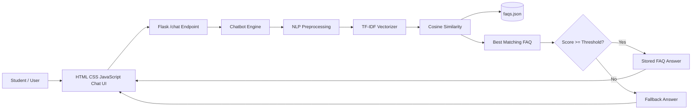
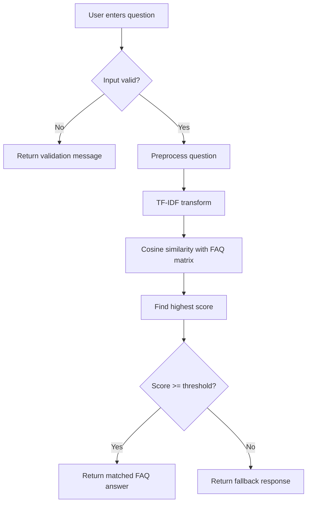

# FAQ Chatbot using NLP and Cosine Similarity

## 1. Title

**FAQ Chatbot using NLP and Cosine Similarity**

## 2. Abstract

The FAQ Chatbot is a web-based question-answering system designed to provide quick responses to frequently asked college and student-support questions. The system uses Natural Language Processing (NLP) techniques to preprocess user questions and a retrieval-based matching approach to identify the most relevant FAQ. TF-IDF converts FAQ questions into numerical vectors, while cosine similarity measures how closely a new user question matches each stored FAQ question. A configurable similarity threshold prevents the system from returning an unrelated answer when no sufficiently relevant FAQ exists. The system is implemented using Python, Flask, NLTK, scikit-learn, HTML, CSS, JavaScript and a JSON dataset.

## 3. Introduction

Students often need quick answers about admission, fees, examinations, attendance, scholarships, hostel facilities and student services. Frequently repeated questions consume staff time and may cause delays when students search through notices or contact different offices. A lightweight FAQ chatbot can provide immediate answers for common questions through a simple web interface.

Unlike a generative chatbot, this project retrieves answers only from a controlled FAQ knowledge base. This makes the behavior easy to demonstrate, understand and maintain in an engineering project.

## 4. Problem Statement

Students may find it difficult to locate accurate answers to frequently asked institutional questions. A manual support process can be repetitive and slow. The project aims to create a simple automated FAQ assistant that matches natural-language questions with a curated FAQ dataset and returns the most relevant stored answer.

## 5. Objectives

- Collect and organize frequently asked questions and answers.
- Preprocess natural-language text using NLP techniques.
- Convert FAQ questions into TF-IDF feature vectors.
- Measure similarity using cosine similarity.
- Apply a threshold before accepting a match.
- Provide a responsive browser-based chat interface.
- Handle invalid, empty, short and unknown inputs safely.
- Provide a maintainable JSON dataset for future updates.
- Test the core NLP and web API functionality automatically.

## 6. Existing System

In a traditional support process, students may depend on notice boards, static web pages, office staff, phone calls or manually searching documents. These approaches can work, but repeated questions can require significant staff effort and users may have difficulty finding the correct information quickly.

## 7. Proposed System

The proposed system provides a web chat interface. A student enters a question, the Flask backend preprocesses it, and the chatbot compares it with all FAQ questions using TF-IDF and cosine similarity. If the best score reaches the configured threshold, the stored answer is returned. Otherwise, a fallback response asks the student to rephrase the question or use the available sample questions.

## 8. Scope

The current scope includes student-support FAQs such as admissions, fees, examinations, attendance, scholarships, hostel services, library services, certificates, placements and technical support. The architecture can later be adapted to other domains such as banking, e-commerce, healthcare information, products or institutional services.

## 9. Technologies Used

- **Python:** application and NLP logic
- **Flask:** backend web framework and REST-style endpoint
- **NLTK:** tokenization, stopword handling and stemming
- **scikit-learn:** TF-IDF vectorization and cosine similarity
- **JSON:** FAQ storage
- **HTML5/CSS3:** interface
- **JavaScript:** asynchronous chat requests and UI interaction
- **pytest:** automated testing

## 10. System Architecture



## 11. Methodology

The system follows these stages:

1. Collect FAQ question-answer pairs.
2. Validate the JSON dataset.
3. Preprocess all FAQ questions.
4. Build a TF-IDF matrix.
5. Receive a user question through the Flask API.
6. Validate the request and input length.
7. Preprocess the user question with the same function.
8. Transform it using the already-fitted TF-IDF vectorizer.
9. Calculate cosine similarity against all FAQ vectors.
10. Select the highest-scoring FAQ.
11. Compare the score with the configured threshold.
12. Return the stored answer or fallback response.
13. Display the result in the browser.

## 12. NLP Preprocessing

The `preprocess_text()` function performs the following operations:

### Lowercasing

Text such as `WHAT ARE THE FEES?` is converted to lowercase so case does not create unnecessary differences.

### Punctuation and special-character removal

Punctuation is removed so questions such as `What are the fees?` and `What are the fees` are treated similarly.

### Tokenization

The sentence is split into individual word tokens. NLTK tokenization is attempted first, with a regular-expression fallback for environments where the optional tokenizer resource is unavailable.

### Stopword removal

Common words with limited retrieval value are removed where possible. The project includes a fallback stopword set so application startup does not depend on a successful NLTK download.

### Stemming

NLTK's Porter Stemmer reduces related word forms. For example, different grammatical forms can become closer in the feature space.

### Whitespace normalization

Repeated whitespace is collapsed into single spaces.

## 13. TF-IDF Explanation

TF-IDF means **Term Frequency-Inverse Document Frequency**. It gives a numerical weight to words based on how important they are within a question and how common they are across the FAQ collection.

A simplified interpretation is:

```text
TF-IDF(term, document) = TF(term, document) × IDF(term)
```

Terms that are useful for distinguishing one FAQ from another receive stronger weights. This converts text into vectors that can be compared mathematically.

The implementation uses unigrams and bigrams, which helps preserve short phrases such as `student portal` and `admission requirements`.

## 14. Cosine Similarity Explanation

Cosine similarity measures the angle between two vectors. For vectors A and B:

```text
cosine_similarity(A, B) = (A · B) / (||A|| ||B||)
```

A value closer to 1 indicates that the vectors point in a similar direction. In this project, the user-question vector is compared with every FAQ-question vector, and the highest score is selected.

## 15. Chatbot Workflow



## 16. Dataset Description

The project includes more than 40 FAQ entries covering:

- Admission
- Application requirements
- Fees
- Student portal
- Course registration
- Timetable
- Attendance
- Examinations
- Results and revaluation
- Certificates
- Hostel
- Library
- Scholarships
- Internships
- Placements
- Technical support

Each record has exactly two required fields:

```json
{
  "question": "How do I apply for admission?",
  "answer": "You can apply through the university admission portal..."
}
```

The dataset can be edited without changing the matching algorithm.

## 17. Implementation

### Backend

`app.py` creates the Flask application and exposes:

- `GET /` — renders the chat interface.
- `POST /chat` — validates the JSON request and returns chatbot output.
- `GET /health` — provides a simple health/status check.

### NLP Module

`preprocess.py` provides the reusable `preprocess_text()` function.

### Chatbot Module

`chatbot.py` provides:

- Dataset loading
- Dataset validation
- TF-IDF model creation
- Model rebuilding through `reload()`
- Similarity calculation
- Threshold-based response selection
- Input validation

### Frontend

The frontend is built without a UI framework. JavaScript uses `fetch()` to communicate with `/chat` and updates the message area dynamically.

## 18. Testing

Automated tests verify:

1. FAQ dataset loading
2. Text preprocessing
3. Exact FAQ matching
4. Similar questions
5. Different wording
6. Case and punctuation variations
7. Unknown questions
8. Empty questions
9. Short questions
10. Similarity threshold behavior
11. Home page availability
12. `/chat` API behavior
13. Invalid API requests
14. Oversized input handling
15. Health endpoint

Run:

```bash
pytest -q
```

## 19. Results

The application successfully provides a browser-based FAQ conversation flow. Questions with sufficient similarity are mapped to the corresponding FAQ answer, while questions below the configured threshold receive a fallback message. The automated tests verify the principal matching and API behavior.

For a live demonstration, test exact wording, changed wording, capitalization, punctuation, extra spaces and an unrelated question.

## 20. Advantages

- Simple architecture
- Low computational requirements
- No external AI API required
- Easy to explain in an academic presentation
- Easy to update through JSON
- Fast matching for a small FAQ collection
- Threshold reduces obviously unrelated responses
- Responsive interface

## 21. Limitations

- TF-IDF is primarily lexical rather than deeply semantic.
- Synonyms with little word overlap may not match well.
- The similarity score is not a probability.
- Dataset quality directly affects answer quality.
- Policy changes require FAQ updates.
- The system is not a generative conversational model.

## 22. Future Scope

- Sentence Transformer embeddings
- Semantic search
- Intent classification
- Multilingual NLP
- Voice input and output
- Database-backed FAQ management
- Admin dashboard
- Analytics for unanswered questions
- User authentication and role management
- LLM integration with controlled retrieval

## 23. Conclusion

The FAQ Chatbot demonstrates how classical NLP and information-retrieval techniques can be combined with a web application to automate responses to frequently asked questions. NLTK provides text preprocessing, scikit-learn provides TF-IDF and cosine-similarity utilities, and Flask connects the matching engine to a simple browser interface. The threshold-based retrieval approach is transparent and suitable for a controlled FAQ domain, while the modular structure leaves room for future semantic-search and multilingual enhancements.

## 24. References

1. Steven Bird, Ewan Klein and Edward Loper, *Natural Language Processing with Python*, O'Reilly Media.
2. Christopher D. Manning, Prabhakar Raghavan and Hinrich Schütze, *Introduction to Information Retrieval*, Cambridge University Press.
3. scikit-learn documentation — text feature extraction and pairwise metrics.
4. NLTK documentation — tokenization, stopwords and stemming.
5. Flask documentation — routing, request handling and templates.
