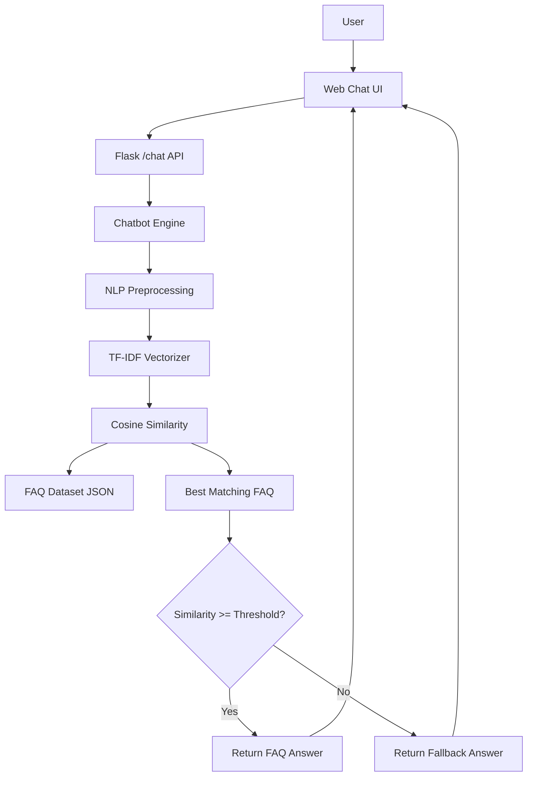

# FAQ Chatbot using NLP

A beginner-friendly, retrieval-based FAQ chatbot built with **Python, Flask, NLTK, scikit-learn, TF-IDF and cosine similarity**. The application answers student-support questions from a JSON FAQ dataset through a responsive web chat interface.

## Project Description

The chatbot does not generate answers with an LLM. Instead, it finds the FAQ question that is most similar to the user's question and returns the answer stored with that FAQ. A configurable similarity threshold prevents unrelated questions from receiving an incorrect FAQ answer.

## Features

- 50+ realistic college/student-support FAQs
- JSON dataset that is easy to edit
- NLTK preprocessing
- Lowercasing, punctuation cleanup, tokenization, stopword removal and light stemming
- TF-IDF vectorization with unigram + bigram features
- Cosine-similarity matching
- Configurable confidence/similarity threshold
- Flask `GET /` UI and `POST /chat` API
- Empty/short/long/invalid input handling
- Friendly fallback for unknown questions
- Responsive HTML/CSS/JavaScript chat interface
- Sample-question buttons
- Loading/"Thinking..." state
- Automated tests
- Health endpoint for quick verification
- No API keys or external AI services required

## Technologies Used

| Layer | Technology |
|---|---|
| Backend | Python, Flask |
| NLP | NLTK |
| Matching | scikit-learn, TF-IDF, cosine similarity |
| Frontend | HTML5, CSS3, JavaScript |
| Dataset | JSON |
| Testing | pytest |

## System Architecture



## Project Structure

```text
faq-chatbot/
├── app.py
├── chatbot.py
├── preprocess.py
├── requirements.txt
├── README.md
├── PROJECT_DOCUMENTATION.md
├── .env.example
├── .gitignore
├── data/
│   └── faqs.json
├── templates/
│   └── index.html
├── static/
│   ├── style.css
│   └── script.js
└── tests/
    ├── test_chatbot.py
    └── test_app.py
```

## How It Works

```text
User Question
     ↓
Text Preprocessing
     ↓
TF-IDF Vectorization
     ↓
Cosine Similarity
     ↓
Find Best FAQ
     ↓
Similarity Threshold
     ↓
Return Answer / Fallback
     ↓
Display in Chat UI
```

1. The FAQ JSON file is loaded when Flask starts.
2. Each FAQ question is preprocessed.
3. The cleaned questions are converted into TF-IDF vectors.
4. A user question is cleaned using the same preprocessing function.
5. The user's vector is compared with every FAQ vector using cosine similarity.
6. The highest score is selected.
7. If the score is at least `0.30`, the associated FAQ answer is returned.
8. Otherwise the chatbot returns a fallback message.

## Installation

### 1. Create a virtual environment

```bash
python -m venv venv
```

### 2. Activate it

**Mac/Linux:**

```bash
source venv/bin/activate
```

**Windows:**

```bat
venv\Scripts\activate
```

### 3. Install dependencies

```bash
pip install -r requirements.txt
```

For running tests, install pytest if it is not already available:

```bash
pip install pytest
```

### 4. NLTK resources

The application checks for the NLTK stopword corpus without making startup depend on internet access. If the resource is missing, it automatically uses a small built-in stopword fallback and a regex tokenizer, so startup does not fail.

If you want to install the standard stopword resource manually:

```bash
python -c "import nltk; nltk.download('stopwords')"
```

## Running the Application

From the project directory:

```bash
python app.py
```

Open:

```text
http://127.0.0.1:5000
```

You can also verify the backend with:

```text
http://127.0.0.1:5000/health
```

## Configuration

The default threshold is `0.30`. You can change it without editing Python code.

Mac/Linux:

```bash
FAQ_THRESHOLD=0.35 python app.py
```

Windows PowerShell:

```powershell
$env:FAQ_THRESHOLD="0.35"; python app.py
```

The `.env.example` file documents the available environment variables, but no `.env` file is required.

## Testing

Run all tests:

```bash
pytest -q
```

The test suite covers dataset loading, preprocessing, exact matching, similar wording, punctuation/case/spacing, unknown questions, empty/short questions, threshold behavior, the home page, `/chat`, invalid requests and the health endpoint.

## Example Questions

Try these in the browser:

1. `How do I apply for admission?`
2. `What documents are required for admission?`
3. `WHAT ARE THE COLLEGE FEES???`
4. `How can I get admission to the college?`
5. `I forgot my student portal password. What should I do?`
6. `Where can I find the exam timetable?`
7. `How do I get a bonafide certificate?`
8. `Is hostel accommodation available?`
9. `How can I apply for a scholarship?`
10. `Tell me about the weather on Mars tomorrow`

The last question should normally trigger the fallback response.

## Adding or Editing FAQs

Open:

```text
data/faqs.json
```

Add an object with exactly two required fields:

```json
{
  "question": "How do I request a transcript?",
  "answer": "Submit a transcript request through the student services office or portal."
}
```

Restart the Flask application after changing the dataset so the TF-IDF model is rebuilt.

## API

### `POST /chat`

Request:

```json
{
  "message": "How can I apply for admission?"
}
```

Response:

```json
{
  "answer": "You can apply for admission through the university admission portal...",
  "confidence": 0.84,
  "matched_question": "How do I apply for admission?"
}
```

### `GET /health`

Returns application status, FAQ count and configured threshold.

## Limitations

- This is a retrieval-based chatbot, not a generative AI chatbot.
- It can only answer questions covered by the FAQ dataset.
- TF-IDF mainly captures lexical overlap and does not fully understand language meaning.
- The similarity score is not a calibrated probability of correctness.
- Answers must be updated manually when policies, fees or dates change.

## Future Enhancements

- Sentence Transformers and semantic embeddings
- Intent classification
- Multilingual support
- Voice input/output
- Database-backed FAQ management
- Admin dashboard
- Analytics and unanswered-question reporting
- LLM integration for broader conversational coverage

## Security Notes

- User input is treated as plain text and never executed.
- Input length is limited.
- JSON request structure is validated.
- Server exceptions are logged server-side without exposing stack traces to users.
- No credentials or API keys are hardcoded.
- The virtual environment and environment files are excluded by `.gitignore`.
